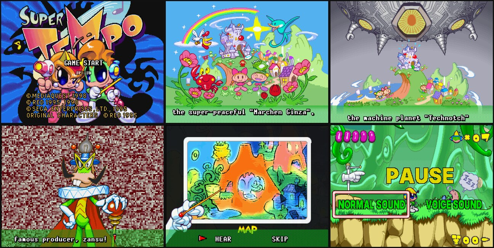

# Super Tempo – English translation (Sega Saturn)

Fan translation of **Super Tempo** (スーパーテンポ, Media Quest / Red Company, developed by Aspect, Sega Saturn, Japan 1998, T-26413G) into English.

**Current version: v0.9.1** – the whole game is playable in English: story, dialogue, shops, appraisal,
ending, title menu and most graphics that contain Japanese text.

Translated using AI (Claude) by [RetroPlayingBCN](https://www.retroplayingbcn.es).

**[⬇ Download the latest release](https://github.com/Retroplayingbcn/super-tempo-english/releases/latest)**

*(Versión en español más abajo.)*



## What's translated

- All dialogue and narration: Major Minor's intro, Kanteimaru, the Techno Mask scene, the attract-mode story
  and the ending letter and narration.
- Title menu, options, difficulty, HEAR/SKIP prompts.
- Prize shops (bird shop and Mussies shop), the final appraisal and its verdicts.
- Ending: rank titles, "It's "…"-chu~!!" messages, THE END screen and the round-select cheat screen.
- Graphics redrawn in English: pause menu (PAUSE / NORMAL SOUND / VOICE SOUND / CONTINUE / QUIT) in every stage,
  the boss 1 hint, the round 5 quiz answers, CROAK! / RIBBIT!, LO~VE, ZZZT! / CLUCK! / BAWK!, the frog song
  (romaji bubbles), PILES / MARS signs, BREMEN BAND, KEEP / OUT!
- The credits were already in English; they now use the narrow font.

## Known issues / still to do

- The 長者番付 ("rich list") banner of the ending ranking is still in Japanese.
- The ドレミ columns in the final boss arena are still in Japanese.
- One tester got a hang after the final boss on real hardware with a SAROO cartridge. It has not been
  reproduced, and the patch doesn't change code in that stage (only the pause graphic). Reports welcome.
- The script will get a polish pass in a future revision.

## How to patch

You need your own dump of the game (Redump: `Super Tempo (Japan)`, 3 tracks). This repository does **not**
contain any game data, disc image or BIOS.

1. Check track 1: `Super Tempo (Japan) (Track 1).bin`, MD5 `c99185b36312de4faed74200538d7705`.
2. Apply `patch/SuperTempo_EN_v0.9.1_track1.xdelta` to track 1 with [xdelta3](https://github.com/jmacd/xdelta)
   or Delta Patcher:

   ```
   xdelta3 -d -s "Super Tempo (Japan) (Track 1).bin" SuperTempo_EN_v0.9.1_track1.xdelta "Super Tempo (English) (Track 1).bin"
   ```

   Result MD5: `740224955ef821c33ec5dd2a03558bba`.
3. Tracks 2 and 3 and the `.cue` are unchanged. If you renamed track 1, edit the `.cue` to match.

Tested in Mednafen and on a Japanese Saturn with SAROO.

## Repository contents

| Folder | What |
| --- | --- |
| `patch/` | The xdelta patch for track 1 |
| `script/script_en.txt` | English script (edit this to change the text; max. 32 characters per message) |
| `script/script_ja.txt` | Japanese script as extracted from the disc, for reference |
| `tools/` | Build scripts (Python 3 + Pillow), graphics relabelling, SH-2 test simulator, Mednafen helpers |

### Building from source

```
python3 tools/build.py <extracted_files> script/script_en.txt <original_folder> <output> <track1.iso>
```

With `DUMP=1` it also writes the patched files to `<output>/files/`. The graphics step needs Pillow and the
Inter and DejaVu Sans Bold fonts; the narrow text font is generated from X11 `6x13B`.
Some test and emulator scripts still have the working paths used during development (`/root/st`, `/root/v2`);
adjust them to your setup. Comments in the tools are in Spanish.

### How the text works (short version)

The game uses its own 16-bit text encoding (font index + 1, no Shift-JIS) with a 16×16 font. The patch changes
the text routines to read 8-bit codes and advance 8 px, puts a narrow Latin font in the kana slots, and uses
two-letter glyphs where a routine still advances 16 px (title menu, appraisal categories). Text that the game
builds with immediate instructions (attract story, Techno Mask card) is rewritten by `tools/subs.py`.
Graphics with Japanese text are uncompressed 4bpp VDP1 sprite pieces and are redrawn by `tools/gfx/`.

## Credits

- Translation and hacking: [RetroPlayingBCN](https://www.retroplayingbcn.es), with AI (Claude)
- Original game: © Media Quest 1998, © Red 1995-1998, © Sega 1995. Super Tempo is a trademark of its owners. This is an
  unofficial fan project, not affiliated with them.

---

## Español

Traducción al inglés de **Super Tempo** para Sega Saturn. Versión actual **v0.9.1**: el juego se puede jugar
entero en inglés. Para parchear, aplica `patch/SuperTempo_EN_v0.9.1_track1.xdelta` a la pista 1 de tu volcado
Redump (MD5 de partida `c99185b36312de4faed74200538d7705`, resultado `740224955ef821c33ec5dd2a03558bba`);
las pistas 2 y 3 y el `.cue` no cambian. Pendiente: el cartel 長者番付 del ranking final, las columnas ドレミ del jefe
final y un posible cuelgue tras el jefe final en SAROO (sin reproducir). El historial completo de versiones está
en [CHANGELOG.md](CHANGELOG.md).
